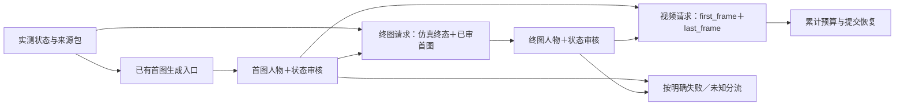

# 状态锚图接线候选 v2

2026-10-22。独立、可选入口；没有替换论文冻结快照、历史生成器或独立验收器。可执行范围仍是有完整严格来源证据的苹果搬运。

同日后续已完成第一次真实首尾图视频生成：2 次图像＋1 次视频，原人物／状态规则通过，实际 payload 的两张图片字节核对通过。结果为约 8.04 秒的苹果搬运视频，45 个采样帧支持必要动作顺序；接触细节仍有遮挡。见 [实测报告](../../notes/HUMAN_VIDEO_CONTINUATION_20261022.md) 与 [播放页](../five_task_probe_20261022/results/human_generation/index.html)。外部 Codex 完成观察与调度，候选仍无内嵌 LLM policy，也没有因此获得全任务泛化或完整配对放行。

## 实际改变

1. 复用现有条件编译器生成终图请求：主输入是实测仿真终帧，支持输入是已审人类首图。图像结果落盘为 `human_terminal.png`，保存实际响应、调用账本、来源、角色、相机和终态上下文的绑定。
2. 首图和终图分别通过原有 `single_actor_v2.1`、`static_state_v1.0`，才允许准备视频。发送的实际 payload 包含 `first_frame` 和 `last_frame`；执行前重验所有绑定及图片与 provider 响应的一致性。相同图片不能冒充变化前后状态。
3. 新修复路由从上述 gate 现算结果。明确错误转入条件诊断；未知转入证据补充；旧版“两只手通过”不能替代单人审核。`prepare-review` 实际产生绑定仿真对照、人体计划、任务合同、规则及全部 unknown 的模板，不伪造视觉观察。
4. 继续复用累计预算、并发锁和未知提交保护。已保存 task ID 可恢复本地记录再查询；未知 POST 不自动重发；已终结任务不自动重抽。
5. 本轮新增 `agent_step.py` 与 `step` CLI：根据当前 gate 实际执行一个本地准备步骤，保存 journal、输入/源码指纹与产物绑定；相同输入恢复已有步骤。确认视觉错误时写出可证伪的修复 brief，尚不执行生成修复。
6. `prepare-review` 增加可供观察者使用的 `review_instructions.txt` 和 `observer_input.json`，绑定候选图、仿真对照与模板，先描述可见内容再与预期比较。它是定向审图提示，不是盲评或自动视觉检测。



图中审核器校验独立观察和绑定，不是自动视觉识别模型。首尾合格仍不证明视频中途接触、人物身份、必要事件或连续性，所有产物保持 `quality_release_approved=false`、`training_admitted=false`。

## 运行与恢复

从项目根目录使用 `PolicyGen/.venv/bin/python corl2026_workshop/experiments/state_anchor_v2/run.py --help`。

| 命令 | 输入／输出及触发条件 |
|---|---|
| `prepare-terminal` | package、首图、两份首图审核、public config → 新目录的终图请求与 job；审核未过仅保存 blocked 请求 |
| `execute-terminal` | job、同一 config、显式 budget → 终图及 provenance；未通过 gate 或额度不足先于凭据读取和 API 拦截 |
| `prepare-review` | package、图像、initial/terminal、全新目录 → 对照引用、两份 unknown 模板；需要观察者填写证据 |
| `diagnose` | 来源包、首尾图与审核，可选已有 video request/budget → 重算 gate 或恢复分支；不调用生成 API |
| `step` | diagnose 的输入＋config、workspace → 执行一次 review/terminal/video 准备或写修复 brief；固定步骤上限，可恢复，不调用 provider |
| `prepare-video` | package、首图、两份首图审核、终图 provenance、两份终图审核、config → 新目录的真实首尾图片 payload；缺证据只写 blocked gate |
| `execute-video` | video request、config、budget → 提交已有 provider 适配器；逐项重验且累计计费调用 |
| `recover-video` | video request、原 budget → 从账本中已有 task ID 恢复 origin；无 POST |
| `poll-video` | 提交目录、同一 public config → 查询原任务及下载；不提交新任务 |

生成命令仅在需要时从 `--credentials` 的私有配置读取。初次本地接线验证的预算为零；后续苹果小样已在新的有界预算内完成，详见上方记录。新增终图增加一次图像生成及审核；实扣费用和相对基线的视觉收益仍未测，不能声称等成本改善。

调用示例（全部为本地准备；变量指向已有合格材料）：

```bash
PolicyGen/.venv/bin/python corl2026_workshop/experiments/state_anchor_v2/run.py prepare-terminal \
  --package "$R2H_PACKAGE" --image "$R2H_INITIAL" \
  --actor-review "$R2H_INITIAL_ACTOR_REVIEW" --state-review "$R2H_INITIAL_STATE_REVIEW" \
  --config "$R2H_PUBLIC_CONFIG" --output "$R2H_NEW_TERMINAL_DIRECTORY"
```

后续首图／终图审核应另存完成版，保留 unknown 模板，不修改历史审核文件。修改条件、审核或源码会使旧请求失效；使用新目录保存新候选。修复路由不自动修改人体计划、编辑图像或执行分段重生成，缺少这些 handler 时明确停止，不返回“已修复”。

### 给外部 agent 的单步入口

```bash
PolicyGen/.venv/bin/python corl2026_workshop/experiments/state_anchor_v2/run.py step \
  --package "$R2H_PACKAGE" --initial-image "$R2H_INITIAL" \
  --config "$R2H_PUBLIC_CONFIG" --workspace "$R2H_AGENT_WORKSPACE"
```

首图审核可用 `--initial-actor`、`--initial-state`；后续使用 `--terminal-provenance`、`--terminal-actor`、`--terminal-state`。已有视频请求通过 `--video-request` 与原 `--budget` 诊断恢复。`--max-steps` 默认为 8，创建 workspace 后不可改变；这是本地执行步数限制，收费仍由原 canonical campaign ledger 控制。

executor 是确定性的工具层，没有内嵌 LLM policy。它区分缺少生成首图 provenance 与已有图缺少观察；前者不能靠反复审核仿真图解决。`actions_executed` 只列实际执行的准备动作。重复输入检查旧结果及产物 hash；中断/未知提交不会自动重放。生成请求、视觉修复、最终视频审核仍由外部 agent 与原预算/规则接口继续处理。

## 来源路径与复现边界

真实包重验发现冻结快照的目录改变会导致条件编译器／scene_proposals 的绝对路径绑定不一致，即使 SHA 相同。没有删除这些字段或放宽检查。`bootstrap.py` 对 `pipeline/source_manifest.json` 中全部 619 文件核对原完成运行目录与论文快照的字节，随后从证据所绑定的原目录导入。缺文件或不一致即停止，不导入未完成的 continuation。

因此这是一条当前工作区内可复跑的入口，尚不是搬到任意机器即可执行的发布包。跨机器复现需要明确的来源重定位／重新编译协议；不能通过改 path 或 hash 静默“修好”证据。

## 验证与下一步

`tests/` 用标明的测试图片／观察验证实际适配器的传输、来源错绑、篡改、失效审核、旧规则、unknown、预算和提交恢复；所有正例仅是软件测试。`audit_local.py` 用历史真实执行包复跑源码核验、物理／相机／来源重验、准备和零预算拦截，并重放历史人物观察。它不产生新的视觉评价或新任务成功率。

本轮候选套件 **31 项通过**（原有 22＋新增 9）；上一轮 89 项冻结依赖测试和 13 个子项的结果保留，未为本轮重复计数。`audit_agent_step.py` 又对三个真实历史执行包各调用两次，首次均为 `initial_generation_required`，重复均恢复已有步骤，共 22.552 秒，账本 image/video/review 前后全为 0。结果见 [audit.json](../agentic_local_20261022/run_01/audit.json)。真实输入只覆盖该分支，其他正向准备路径由标识的测试图与 mock 验证。

详细 agentic 审查、prompt 和跨具身任务设计见 [续研报告](../../notes/AGENTIC_PIPELINE_AND_PAPER_20261022.md)。当前编译器仍有线性事件、初态双手空闲、末态双手释放等任务假设；后续扶稳/交接任务需要按契约扩展，不能只加新任务名字。

后续仍需实验：单一身体条件图是否比直接编辑机器人画面可靠；经审核终图能否减少状态错误，且不损害接触／对象保持。目前已有一个按现行规则通过的首尾图及真实视频样例，下一步应使用共享首图做有界对照，并测试接触可见性。单例和软件测试均不足以晋级全任务默认管线，论文不新增未测的成功率。
