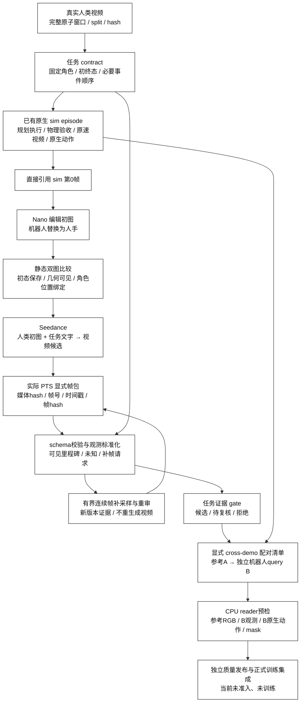

# 真实人类任务 → 原生仿真 → 合成人类参考：当前架构

更新：2026-10-20，本轮完成版。本文依据实际代码、视频、审查证据和配对快照编写，区分已完成的小批量生成、已实现接口和尚未接通的能力。4段合成人类视频已齐，显式配对与CPU预检已完成；自动质量发布为0、训练准入为0，没有启动策略训练或真机执行。

核心数据单位不是“同名任务的一堆视频”，而是一条有来源的链：**完整真人任务窗口 → 固定对象角色和必要事件 → 已有成功仿真执行 → 合成人类参考候选 → 显式指定的独立机器人 query**。机器人观测和机器人动作始终来自同一原生 episode；合成人类视频只提供任务参考。

## 本轮范围与状态来源

输入清单是 [batch_20261020b/input_manifest.json](/mnt/sdg/datasets/real_sim_human_pipeline/batch_20261020b/input_manifest.json)。本轮有 4 个 job，覆盖 3 种任务、3 个独立真人窗口、4 条已有机器人轨迹。两种苹果布局复用同一真人窗口，不能计为两段独立真人演示。

| Job | 真人原生窗口，起含止不含 | 已有机器人轨迹 | 本轮合成路径 |
|---|---|---|---|
| `apple_bowl_transfer_891910000` | 2174，30fps，`[0,246)` | 302帧，20fps；黑碗图像左源→右目标 | 新 Nano 初图、新 Seedance 请求 |
| `closed_book_to_open_box_891912000` | 388，30fps，原片383帧中的`[190,261)` | 411帧，20fps；右下闭合书→中央开盒 | 新 Nano 初图、新 Seedance 请求 |
| `right_cabinet_open_only_891914000` | 1766，30fps，`[0,72)`；父片434帧 | 499帧，20fps；打开图像右门 | 新 Nano 初图、新 Seedance 请求 |
| `apple_bowl_transfer_891911000` | 与第一行相同的真人2174 | 327帧，20fps；白碗图像右源→左目标 | 复用既有初图和 `role_grounded.mp4`，重新审查 |

**本轮没有新生成4条机器人轨迹。** 原生仿真数据来自既有 pilot；891911000 的合成人类视频也复用既有结果。其余3个 job 走真实的新图像/视频请求，不能把复用单元再计入新增出片数量。

本轮终态统计如下；出片、格式有效、任务可读、证据充分和训练批准是不同结果：

| 统计口径 | 本轮结果 |
|---|---|
| 合成人类视频 | 4段已落盘：3段新生成＋1段复用 |
| 视频实际时钟 | 4段均为24fps、193帧，首PTS为0，末帧PTS为8.0秒，按帧间隔计算总时长约8.0417秒 |
| 新增机器人轨迹 | 0；4条生成donor及独立query均来自已有原生sim |
| 显式cross-demo配对 | 4条，集合级来源/文件/split校验通过 |
| CPU固定样本读取 | 12次通过：每条边读取query首帧、中帧、末帧 |
| 任务证据gate | 4条最新审查分支均为`needs_review` |
| 自动质量发布 / 运动验证 / 训练准入 | 0 / 0 / 0 |

配对与读取依据是不可变快照 [`ac81e404ed146b5638ca/summary.json`](/mnt/sdg/datasets/real_sim_human_pipeline/batch_20261020b/training_pair_inspection_snapshots/ac81e404ed146b5638ca/summary.json)。独立视觉复核把新黑碗、书本判为task-only可读候选；柜门的开右门子动作可读，但存在额外可见手和柜内对象保留未建立的问题。这些视觉结论没有把gate或训练标志改为通过。完整运行证据仍保存在：

- [BATCH_STATUS.json](/mnt/sdg/datasets/real_sim_human_pipeline/batch_20261020b/BATCH_STATUS.json)：主runner保存的各job状态快照。
- [jobs 目录](/mnt/sdg/datasets/real_sim_human_pipeline/batch_20261020b/jobs)：各 job 的 `STATUS.json`、请求回执、轮询结果、下载视频、帧包、review 和 gate 文件。
- 总表可能早于某个恢复进程的单 job 状态；报告终态前必须同时检查各 `jobs/*/STATUS.json`、产物及其 hash。

轮询状态解析曾出现`invalid_task_status`，之后沿已有task ID只读恢复并取得视频，没有重新提交这些视频请求。白碗复用单元的原始`review_schema_violation`及raw回复仍保留；后来只做确定性容器形状适配，没有伪装成原始回复已符合schema，详见下文。

## 实际数据流

图中 sim 节点在本轮是**复用与重新核验输入**。既有 `human_to_robot_pipeline` 可以执行任务专家、原生采集和 CPU 验收，本轮 `batch_pipeline.py` 没有调用它再采集。

图中补帧返回边表示本轮已经实用的一次显式、有预算的重审入口，不是无人值守地循环收费或无限重审。配对/CPU检查在`inspection`模式允许读取未发布候选，不能把图中的连接理解成gate已批准训练。

Seedance 当前接收的是一张人类初图和语义提示；没有接收原生机器人视频、逐帧动作、mask、depth 或相机几何。因此本链路目前生成的是**相同任务目标与必要顺序的人类候选**，不能声称保留机器人逐帧运动、接触力或三维轨迹。

## 每个阶段负责什么

| 阶段 | 当前实现与产物 | 不能据此推出的结论 |
|---|---|---|
| 真人来源固定 | 冻结任务规格 `human_grounded_task_spec.json`；保留视频hash、原始fps、精确帧窗、原session、split和人工审查材料 | 不能只凭任务名或字幕生成目标；局部原子窗不代表完整复合任务 |
| 任务 contract | `batch_pipeline.contract_for`支持苹果、闭合书入开盒、右柜门；`validate_contract`检查关系、事件实体、偏序、来源hash | contract是要求，不是视频已经满足要求的证据 |
| 原生仿真输入 | 已有原生video/arrays/receipt/QA；本轮重新核对路径、hash、完整解码、224/512时间轴、初终帧和stage区间 | 历史机器人物理成功不能转移为合成人类物理成功；本轮没有重跑全部历史物理/FK验证 |
| 人类初图 | 新3条使用 `gemini-nano-banana-2.1`；直接读取已有sim第0帧，生成只替换本体的候选 | 图像模型不提供几何硬约束；“看起来像人”不等于初态正确 |
| 静态对照及角色绑定 | 两张独立静态图一同送审；检查初态、对象数量/身份、关键几何、机器人残留；记录编辑图中的固定角色位置 | 不是把两张静态图当连续视频；VLM的`yes`仍是视觉判断，不是像素测量 |
| 视频生成 | Seedance以编辑图为first-frame，8秒/720p请求，使用初态、必要动作、终态与固定角色文字 | 不假设请求8秒就一定精确8秒，也不把自然语言当运动控制 |
| 显式取帧 | `frame_packet`读取`ffprobe best_effort_timestamp_time`，保存实际帧号、PTS、图像hash和源视频hash；包含真实起止帧及全片覆盖点 | 稀疏帧不能排除帧间瞬移、短暂错误或未看到的接触 |
| 定向观测 | `task_review`生成严格schema，隐藏期望真假值、目标ID及事件义务/偏序；只允许引用实际提交的帧与时间戳 | 查询谓词仍会引导审查，并非盲审；JSON格式正确不等于任务正确 |
| 连续帧补采样 | `refinement.py`和`--refine-from`按未知区间编排预算，保留基准覆盖，新增连续原帧并另存审查版本；书本已实测 | 补取帧本身不是语义验证；预算外请求保持延期，不能用稀疏替代连续覆盖 |
| 协议形状适配 | `review_protocol.py`只将完整event对象包装为singleton list；保留raw/failure、字段值、时间与证据；白碗已实测8处 | 派生回复schema通过不代表provider原回复合规，也不等于任务正确 |
| 初图手数检查 | `anchor_body_review.py`按显式渲染计划检查最小可见手数与不确定性；柜门case已实测 | 它不是姿态估计或解剖真值；柜门返回最少2手、精确数未知，仍不放行 |
| 证据gate | `task_evidence`核对来源、初终边界、事件签名、一次事件对应一次必要步骤、偏序、禁止事件与测量作用域 | 不运行tracker、不重建物理；confidence不作为正确率；当前不批准训练 |
| 显式配对与CPU输入 | `training_pairs`提供单边/集合校验、显式查找、cache身份及独立CPU读取；本轮4条边/12次读取已落盘通过 | 独立CPU预检不等于旧生产reader已打通，也不审批参考质量 |

代码入口：[batch_pipeline.py](r2h_pipeline/batch_pipeline.py)、[task_review.py](r2h_pipeline/task_review.py)、[task_evidence.py](r2h_pipeline/task_evidence.py)、[training_pairs.py](r2h_pipeline/training_pairs.py)。原生仿真与物理验收入口说明见 [human_to_robot_pipeline/README.md](human_to_robot_pipeline/README.md)。

本轮新增并实用的补充模块：[refinement.py](r2h_pipeline/refinement.py)、[review_protocol.py](r2h_pipeline/review_protocol.py)、[anchor_body_review.py](r2h_pipeline/anchor_body_review.py)。

任务定义中的关键差别必须保留。苹果源是“最初装着苹果的碗”，目标是“最初唯一空碗”，不能在苹果移动后重新定义源；机器人程序名 `to_right` 也不表示图像右侧。书必须保持闭合，盒子初态已经打开；真人可扶盒、盒内可有衣物，仿真盒固定且为空，这属于既有规格明确的支持差异。柜门只允许开右门并释放，不得把随后取柜内块或开左门带入这个原子任务。

## 观测、证据与批准分开保存

每次新付费阶段先固定 `request_metadata.json` 的输入指纹，再以独占方式创建 `call_started.json`；成功结果和失败状态单独落盘。相同输入已有结果时可复用；输入变更不能借用旧阶段结果；有started但没有确定结果时禁止自动重发。这处理的是执行幂等与成本风险，不能代替内容质量审查。

`task_review.normalize_review`不仅检查JSON，还校验review文件内容、视频hash、提交帧hash、帧号与精确PTS。它区分：

- `visible_milestone`：某帧直接看见的状态里程碑，起止时间必须是同一个实际时间点；不倒推出动作起点。
- `visible_transition`：由提交帧覆盖的可见变化；若区间跨越未提交的原始帧，连续变化证据降为未知。
- 缺证或遮挡：输出`unknown`与`refinement_requests`，不补造接触和时间。
- “没有看到禁止动作”：稀疏帧的未检出会降为未知，不能证明整个视频都没有发生。

证据gate区分 `rejected`、`needs_review`、`task_equivalent_candidate` 和有限作用域的 `motion_verified`。当前batch设置 `motion_requirements=[]`，因此不能得到运动验证通过。稀疏VLM帧审查还无法独自建立禁止事件的全片排除证据，出现 `FORBIDDEN_EVENT_COVERAGE_MISSING` 是明确的证据缺口，应补覆盖，而不是删除禁止项或把unknown改成通过。

`refinement_requests`现在已经接到有界连续帧补采样和一次重审：`--audit-only --refine-from <旧审查> --review-name <新版本> --frame-budget 48`只处理既有视频，检查旧证据和帧包绑定同一媒体，并优先完整纳入短区间。不能装入预算的请求写为`deferred_budget`；若没有新增证据则不发付费重审。原视频、原审查与失败记录不覆盖。

书本的实际补采样是原24帧包中的`[68,79]`两端之间增加10帧，使该区间12个原生帧全部提交，总审查帧数变为34。重审后`grasp_book`及其它必要事件全部匹配；仍因`open_book`、`move_box`两个禁止事件缺少全片排除证据而保持`needs_review`。这说明“补连续证据后局部不确定性解除”已经实测，而全任务放行尚未完成。证据：[refinement_plan.json](/mnt/sdg/datasets/real_sim_human_pipeline/batch_20261020b/jobs/closed_book_to_open_box_891912000/task_review_dense_refinement_v1/refinement_plan.json)、[补帧后gate](/mnt/sdg/datasets/real_sim_human_pipeline/batch_20261020b/jobs/closed_book_to_open_box_891912000/task_review_dense_refinement_v1/gate_decision.json)。

白碗复用视频的协议适配分支`task_review_protocol_shape_adapter_v1`读取已保存raw回复，把8个完整event对象分别包装成长度1的list。适配器验证前后item内容hash相同，不增补字段、不改真假值、不重建时间、不新增证据，且没有调用provider。派生回复通过原schema，但`provider_schema_compliant=false`；原raw与failure不变。随后gate仍为`needs_review`：终态支持关系引用时间偏早，加上3个禁止事件覆盖未知。证据：[适配sidecar](/mnt/sdg/datasets/real_sim_human_pipeline/batch_20261020b/jobs/apple_bowl_transfer_891911000/task_review_protocol_shape_adapter_v1/result.json)、[适配后gate](/mnt/sdg/datasets/real_sim_human_pipeline/batch_20261020b/jobs/apple_bowl_transfer_891911000/task_review_protocol_shape_adapter_v1/gate_decision.json)。

柜门初图的focused手数检查报告`minimum_visible_hand_count=2`、`exact_count_known=false`，没有正确识别精确3手；决策因此为`needs_review/visible_hand_count_ambiguous`，没有放行。独立实际看图观察到左1右2共3只可见手；这是计划外额外手/参与者表现，不能写成解剖不可能。focused检查是在本轮问题发现后的专门审查分支，不应声称3个初图均已在视频提交前经过它。证据：[手数审查结果](/mnt/sdg/datasets/real_sim_human_pipeline/batch_20261020b/jobs/right_cabinet_open_only_891914000/anchor_body_inventory_v1/result.json)、[手数gate](/mnt/sdg/datasets/real_sim_human_pipeline/batch_20261020b/jobs/right_cabinet_open_only_891914000/anchor_body_inventory_v1/decision.json)。

这些模块没有形成无限自动修复循环，也未自动完成独立盲描述交叉检查。当前独立视觉复核是知晓来源任务的审查，不应称为盲审。后续需用独立盲描述与定向观测交叉核对，冲突时回到实际原帧。

所有这些阶段仍保留 `training_admitted=false`、`quality_release_approved=false`。`completed_candidate_audit`只表示审查步骤完成，必须再读gate的decision与issues；“completed”不能作为合格样本筛选条件。

## 显式cross-demo配对和CPU reader预检

目标配对形式是 **参考来自执行A，机器人query来自同任务的独立执行B**。参考视频的`group`不能仅改一个名字冒充独立：应保留A的来源root、机器人donor与真实人类session；query保留B原episode row与B的视频、arrays、receipt。这样能检查同组、同源内容及跨split泄漏。

`training_pairs.validate_pair`只承认一条明确声明的边：

- `reference`必须是`synthetic_human/reference_only`，`action_space=null`、`arrays=null`、`human_wrist_3d_gt=false`。
- query的原episode row必须与hash绑定的源manifest完全一致；当前适配器要求`simulation_expansion`、`panda_eef14_v3`和`target_start_offset=0`。
- 三者split一致，query ID明确列在`allowed_query_episode_ids`中；禁止按goal自动扩展候选池。
- goal key不同时，需要显式任务等价关系与绑定证据；训练模式还需要该关系单独批准。
- cross-demo要求参考与query不同group；集合检查lineage、reference内容hash/ID、query ID、robot group和arrays内容不能跨split。
- `inspection`始终不能训练；`training`要求参考和配对双方显式批准、文件核验及query动作标签验证。批准布尔值是接口门槛，实际发布仍需独立质量证据和权限，不能由生成脚本自行置真。

`reference_cache_key`使用实际参考视频内容hash、clip窗口、fps/length、encoder身份与revision、取帧方法、图像尺寸和预处理设置。改视频、剪窗、取帧策略或encoder后必须得到新key；不能复用来自原真人全片、旧合成视频或另一窗口的teacher cache。

`read_pair_inputs`/`inspect_pair_inputs`在CPU上分别读取参考RGB和机器人query RGB，检查各自fps/PTS，再从query原生数组构造动作及mask：

- 参考帧在自己的完整窗口内采样；query按自己的时间轴选观测。两者没有帧对齐。
- `poses[t]`是当前TCP测量，`target_poses[t:t+H]`是原生命令目标FK；平移和旋转都相对同一个query时刻t计算，不能逐步积分。
- 原生16维命令、18维state保留；14维EEF使用源manifest原归一化参数、有效mask和末尾horizon padding。
- 机器人观测帧t紧邻并先于原生命令t；不能用执行A的动作监督执行B的图像。

本轮实际显式边为：

| 合成参考的sim donor A | 独立机器人query B |
|---|---|
| 黑碗891910000 | 白碗891911000 |
| 白碗891911000 | 黑碗891910000 |
| 书891912000 | 另一书本资产/布局891913000 |
| 柜891914000 | 另一柜门布局891914001 |

4条边的文件、原episode row、显式白名单和集合级split检查通过；54个来源身份键被检查。每条边在query首帧、中帧、末帧各做一次CPU读取，共12次成功；末帧只剩1步有效动作，另外15步按mask补齐，未把尾部padding当真实监督。这些边共享部分真人session/root，但机器人group不同；不同robot group不代表真人来源也独立，所有关联仍留在同一train split中。

实际产物：[pair_manifest.json](/mnt/sdg/datasets/real_sim_human_pipeline/batch_20261020b/training_pair_inspection_snapshots/ac81e404ed146b5638ca/pair_manifest.json)、[fixed_sample_cpu_inspection.json](/mnt/sdg/datasets/real_sim_human_pipeline/batch_20261020b/training_pair_inspection_snapshots/ac81e404ed146b5638ca/fixed_sample_cpu_inspection.json)。CPU报告明确写`production_reader_exercised=false`、`cannot_train=true`，是独立适配器的形状、时钟与动作读取预检。正式生产loader、采样器、参考cache与质量发布接口仍需接入和端到端验证；12次读取成功不能写成“已训练”或“已接通旧生产reader”。

## 本轮最关键的生成约束缺口：首帧不可见的状态

闭柜首帧无法展示柜内彩色块，而生成接口只消费人类首图与文字。打开右门后，原sim终帧上层隔间的彩色块清楚可见，合成终帧却是无法辨认该块的暗腔。视觉上不能据此断言方块被移除，但**柜内对象身份和保留条件没有得到建立**。补强首帧里的可见角色描述，也不会自动补上隐藏对象的视觉证据。

这暴露的是条件信息不足：仅首图加文本不能保证开门后隐藏对象身份。后续应把sim中揭示隐藏状态的关键帧或显式hidden-state条件纳入生成输入，核对对象ID、位置、遮挡状态与门运动时序；所选生成模型也必须确实支持并消费这些条件。必要时评估多关键帧、视频编辑或mask/depth受控路线，再对揭示时刻进行独立审查。当前尚未实现这条条件链，不能只通过改prompt声称问题解决。

完整视觉证据见 [independent_visual_inspection.json](/mnt/sdg/datasets/real_sim_human_pipeline/batch_20261020b/independent_visual_inspection.json)及[简短说明](/mnt/sdg/datasets/real_sim_human_pipeline/batch_20261020b/independent_visual_inspection.md)。黑碗、书本可读是本批有限视觉结果，不证明所有任务都能由同一首帧路线可靠生成。

## 主要训练风险与补齐方式

| 风险 | 当前约束 | 后续需要的实际工作 |
|---|---|---|
| 30fps真人、20fps机器人、生成视频实际fps不同 | 各自独立时钟；保留原帧窗、实际PTS；禁止human/robot逐帧或motor对齐声明 | 对VFR或非零PTS原点建立显式映射；当前CPU适配器会拒绝非CFR/移位媒体。不要静默重标fps |
| 生成图或视频改了初态/对象角色 | 静态双图对照、fixed role grounding、初终态contract | 增加对象身份/数量的定量跟踪与人工复核；抽查全部原始帧上的瞬移与角色交换 |
| 稀疏审查看不见关键接触 | 实际PTS、真实边界、未知；已完成书本有界连续补帧，不能把邻近当抓握 | 对仍未知区间做有预算的后续覆盖；独立盲描述与实际看图；保留遮挡未知 |
| 首帧隐藏对象无法约束后续揭示 | 柜门case已明确标记彩色块保留未建立，没有假装完整条件得到满足 | 接入sim揭示关键帧或hidden-state条件，验证生成器确实消费，再审查打开后的对象身份 |
| 初图增加额外手，整体审查漏检 | 独立看图发现柜门3手；focused检查返回精确数未知并保持needs_review | 将角色/手数预算纳入提交前检查，记录遮挡和最小数；用实际错误样本验证漏检率，不能依赖单次VLM计数 |
| sim成功被误当合成人类物理正确 | sim QA仅用于sim；合成人类禁止借用`sim_measured`证据 | 导出并核对相机、mask、depth；对实际合成媒体运行可校准跟踪，报告限定2D可见作用域 |
| 人类没有可靠3D wrist/force GT | reference无动作数组、无3D GT；姿态、接触、几何输出不能伪装标签 | 若引入估计器，记录来源/误差/可见性并仅按估计量使用；不直接转成机器人motor标签 |
| 同session、同sim donor或重复视频跨split | 显式lineage与集合级split隔离；来源train不借validation | 发布前审计全部传递依赖，包括生成donor、真人session、媒体hash与缓存 |
| 偶然同goal被自动配给不同任务 | 显式query白名单、显式goal等价、不同group | 每条边绑定完整任务证据；不要把类别名或最终截图当全部等价条件 |
| 旧视频/旧窗口缓存污染 | 内容hash与编码配方进入cache key | 正式cache writer/reader共同验证key与输入证据；不借全片teacher cache代表原子窗 |
| `success`/`completed`或schema通过误作训练批准 | generation、schema、gate、release、pair各自标志；inspection不可训练 | 建立独立发布清单和审核记录；训练入口只消费已批准显式边，并跑拒绝路径测试 |

## 尚未接通的能力

以下能力不能计入本轮完成结果：

1. **通用mask/depth/camera条件链。** 现有原生QA和部分分割可见性文件不等于可直接用于视频生成的完整条件包；batch没有向Seedance提交mask/depth。需要统一导出坐标、时间戳和对象身份，并验证下游确实消费条件。
2. **自动对象tracker与运动对齐。** `task_evidence`可对提供的原始二维配对轨迹重算RMSE/coverage，但它不运行tracker、不确认轨迹正确性，也不建立三维接触。需要实际跟踪实现、明确对齐定义、负例校准和可见性覆盖报告。
3. **局部视频重生闭环。** 当前没有“定位失败区间→保持其它帧→局部重生成→边界与任务重验”的统一执行器。已有修复研究和人工重试不能写成通用闭环；任何修复都应产生新媒体hash与新审查，不覆盖旧证据。
4. **通用任意任务编译。** 当前只支持三个已审过的任务族；新任务需先找到完整真人窗口、定义固定角色与允许变化，再验证对应sim专家，不能由自然语言任务名任意外推。
5. **真机与策略训练。** 未执行真机、未训练模型、未测策略收益；独立CPU reader也没有调用旧生产reader。不能报告成百条合格配对、泛化收益、真实部署成功率或训练提升。

本轮已经完成4段视频落盘、独立视觉复核、有界书本补帧重审、白碗确定性协议适配、柜门focused手数检查及4条显式边/12次CPU读取。后续优先处理仍未建立的全片禁止事件覆盖、柜门隐藏对象条件和本体数量约束，再做有限规模、同预算的生成与审查对照。规模统计继续分开报告独立真人窗口、独立sim donor/query、新生成/复用、下载成功、raw/派生schema有效、任务可读、证据gate、运动验证和最终发布数量。本轮最终是0自动质量发布、0训练准入；没有成百条合格数据或训练收益的结论。
