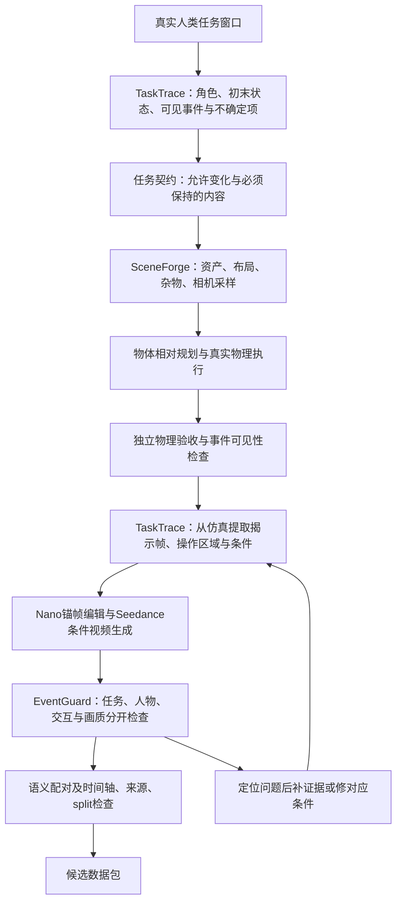

# 从人工填写到任务约束驱动的数据管线

更新：2026-10-20。本轮实现和小样验证，不启动训练。大文件均放在 `/mnt/sdg/datasets/real_sim_human_pipeline/`，旧生产采集器及冻结数据保持不变。

当前最值得研究的主张是：**跨场景、跨本体扩增时，自动保留可辨识的任务目标、关键状态变化和必要交互，并把不确定证据转化为具体修复请求。** 不是生成越逼真的视频就越适合训练，也不是使用更多模型本身就构成创新。

## 一、统一为三个模块

| 名称 | 中文说明 | 输入与输出 | 本轮实际实现 |
|---|---|---|---|
| **TaskTrace** | 任务与事件提取 | 真人窗口→带帧证据的任务草案；仿真状态→关键帧、隐藏状态条件、操作区域候选 | 真人盲提取；分割可见性、标定投影、接触事件；图像匹配与VLM修正 |
| **SceneForge** | 约束保持的场景与轨迹生成 | 任务契约＋资产→随机场景＋可执行机器人轨迹 | 角色契约、布局粗筛、独立实验adapter、杂物进入物理与规划世界、原生独立验收 |
| **EventGuard** | 事件级质量与纠错 | 视频、任务计划、物理证据→分项质量、疑点位置和对应处理分支 | 全解码/PTS；多维VLM评分；手部与局部跟踪；条件修复、有限补帧、来源绑定与失败保留 |

这些是统一讨论用的工作名称。`scene_proposals` 文档中的 SGP 是 TaskTrace 的内部实现，`quality_cascade` 中 EViQ 是 EventGuard 的质量分支；不把每个工具另包装成一个贡献。



图中部分已可独立执行，**通用端到端自动编译还未全部接通**：真人草案不能直接获得新任务仿真资格；当前真实生成仍通过经过检查的任务adapter。生成的人类视频是合成数据，不能叫新采集的real数据，也没有自动得到人手三维真值。

## 二、TaskTrace：哪些人工输入已能自动产生

### 1. 真人视频的任务草案

代码：[human_task_draft.py](r2h_pipeline/human_task_draft.py)；说明：[真人任务草案](HUMAN_TASK_DRAFT_20261020D.md)。

对一个已经选定的真实72帧柜门窗口，给Gemini 24张真实采样帧及PTS；没有提供历史任务文本、机器人状态或期待答案。实际输出了：

- 白色柜体、右门、右侧操作手、左侧静止手、支撑桌面及开门后显露的字母块。
- 初态关门；接近把手→拉开→释放撤手；终态门开且内部物体显露。
- 静止左手与主动右手分开记录，没有因只有一个活动臂就推断只能出现一只手。
- 每条观察引用实际输入帧与PTS，实体与事件引用需通过校验。

输出为 `vlm_draft_requires_independent_review`。本轮验证了格式、引用及时间一致性；VLM语义仍可能错误。“示范中先A后B”记为 observed order；不能从一个视频直接证明所有先后关系都是因果必需。

这是对已有72帧人工选定窗口的事后独立盲提取验证；该新草案尚未用于本轮机器人或合成人类视频生成。

**尚人工/外部提供：** 这次输入窗口本身此前已选定；全库自动分段、长任务的完整性判断、仿真等价任务选择尚未无人化。下一步应利用已有caption检索和运动变化提出窗口，再用重叠窗口与首尾密采样确认，不应让VLM凭标题决定整段任务。

产物：[盲提取任务草案](/mnt/sdg/datasets/real_sim_human_pipeline/automation_20261020d/human_task_drafts/cabinet_blind_v1/draft_task_contract.json)。

### 2. 从仿真记录计算条件，而不是让VLM猜

代码：[scene_proposals.py](r2h_pipeline/scene_proposals.py)；说明：[自动场景候选](AUTO_SCENE_PROPOSALS_20261020D.md)。

- **隐藏状态：** 初帧投影在画内但实例可见像素为0，后续持续显露，自动要求增加揭示状态的视觉条件。
- **关键帧：** 真实接触量变化、显露时刻、最大可见时刻、初末帧；不把控制器阶段名字当接触真值。
- **区域候选：** 用相机内外参和把手几何投影得到源ROI；静态背景由纹理与多帧稳定性提出。
- **跨图定位：** SIFT/RANSAC将源ROI映射到编辑图，输出匹配支持和误差，不冒充语义置信概率。几何变化过大时返回unknown，VLM重新定位。
- **VLM修正：** 保留原proposal，以独立patch修改；禁止把没有候选的框写成keep，禁止改任务标签或授予物理通过。

实际4例：新/旧柜门均找到1个隐藏物体与6关键帧；书与苹果各4关键帧。柜门、书本图像映射有支持，苹果匹配支持不足。苹果真实VLM第一次对未知背景框错误返回keep，校验拒绝；一次显式版本化修复后得到有效框。失败原响应保留。

新柜门自动框已经接入下游跟踪，193/193帧有跟踪支持。说明自动候选能用于诊断，不证明跟踪点始终属于把手或存在真实三维接触。不同视频使用各自时间轴，仿真第330帧不能直接当成人类视频第330帧。

本轮没有用自动提取的TaskTrace条件重新驱动Nano/Seedance生成新视频；当前已验证的是既有视频上的条件候选和诊断自动化。上一轮首尾图生成已成功。本轮验证的是**减少人工条件提取与ROI填写**。

## 三、SceneForge：更随机，但保持任务含义与可执行性

代码与Agent规范：[PLANNING_GUIDE.md](human_to_robot_pipeline/PLANNING_GUIDE.md)。

### 任务契约

契约固定角色、初态关系、目标、禁止变化和事件要求，允许本体、场景、物体外观、布局和合法执行速度变化。

苹果实例：唯一苹果在一个碗里→抓起→放到唯一初始空碗→松手、稳定支撑。增加杂物不能引入第二个同样符合描述的目标，也不能把“从碗里拿”改成“从桌上拿”。左右位置变化是允许的，因为这次目标按占用关系定义；若源任务明确要求左侧目标，就必须保留相应关系。

这里不可用的做法是给agent一句“生成苹果搬运”，然后由同一个脚本自行定义成功。规划与验收应分开，验收读取原始动作、状态、接触与网格。

### 标准规划接口

```text
initialize(case)             创建场景、静置、测量真实角色位姿
plan_stage(stage, scene)     用当前物体坐标系与实际几何解析目标
execute_stage(plan, budget)  只控制机器人；逐帧记录
independent_verify(receipt)  用另一模块验收
```

这个Protocol和文档已落地；旧专家仍整体调用 `solve`，尚未声称所有旧任务都重构成逐stage接口。Agent需读取任务契约、资产尺寸/碰撞模型、原生示例和独立verifier后写adapter。记录开始后禁止改物体pose，规划失败后禁止关闭碰撞或放松成功阈值。

### 随机化策略

把随机变量拆成位置、杂物、外观、相机四组，背景与目标独立抽样。先检查初态角色唯一性、粗碰撞、运输通道、粗可达和关键事件投影，再真实规划和渲染。

本轮范围探索：碗对中心x约−6.5～3.5cm、y±5cm，间距25～35cm、方向±0.35rad；提出0/2/4个杂物层。相机候选也有扰动，但本轮实际运行的4例使用同一基础相机，不能把候选范围当已执行覆盖。

**新增杂物必须同时出现于三个地方：渲染场景、物理碰撞世界、motion planner障碍物。** 只在图里摆杂物而规划器不知道，会制造错误数据。

目前实跑的是2个额外静态可碰撞梨实例，另有原场景非目标物。它们是同一已有模型的实例，不是新增多类几何；动态杂物、完整携带物体连续扫掠碰撞还需补齐。

### 小批真实结果

候选生成器产出12个配置，粗筛拒绝227个配置；**配置数不是轨迹数**。运行4个独立物理候选：

| 候选 | 实际结果 | 记录帧数 | 说明 |
|---|---|---:|---|
| layout_2026102000_v2 | 失败 | 343 | 撤手阶段IK/规划失败；未放宽阈值 |
| layout_2026102001 | 失败 | 242 | 夹持物随机械臂被带离工作区，随后触发相机近裁剪面检查 |
| clutter_2026202018 | 原生物理验收通过 | 475 | 2个额外静态可碰撞杂物 |
| clutter_2026202030 | 原生物理验收通过 | 292 | 另一布局、2个额外静态可碰撞杂物 |

另外有一次环境构造默认seed的工程错误，修复后重跑同一布局，原日志/input保留，单列而不伪装成未尝试。

这4例是开发中的自适应尝试，不是固定分布的随机抽样评估。

对layout2001进一步读取原始状态：释放前下降阶段，苹果相对TCP的位置变化包络仅约0.160mm，夹爪持续闭合；TCP却从任务区走到约`[-0.286,-0.880,0.835]m`，指令FK也指向场外。现有证据支持“机器人携带物体离开工作区”，不支持优先解释为相机位置不好或苹果自行飞脱。未保存整条规划路径及具体Screw/RRT分支，尚不能精确归因。应在执行前记录/验证完整q路径、FK轨迹、终点误差、工作区和局部操作的路径长度；不能只相信planner返回Success。

**随后确认的源码缺陷：** 自定义 `PolicyGen/mani_skill/examples/motionplanning/planner.py` 的Screw分支计算 `collide` 却未用它拒绝路径，并可能将小 `delta_twist` 直接记作成功、缺少返回前终点FK残差检查。必须修正“障碍点云已接入，所以Screw碰撞拒绝已生效”的推断。两个真实执行通过例的原始物理/接触结果仍成立，但不能推出规划器已提供完整碰撞保证。旧生产源码本轮不改，新的扩大采集不能继续继承这种保证。

已经增加独立 [plan_geometry_validator.py](human_to_robot_pipeline/plan_geometry_validator.py)，用保存的joint commands重新计算完整FK轨迹。坏例从第213帧起出现下降高度异常，比最终报错早约29帧；两个原生通过例没有触发当前几何规则。规则是在这次分析中明确的诊断阈值，属于事后重放，不是live拦截效果或校准后的通用检出率。缺失的实际规划终点仍为unknown。

**当前扩大采集入口已默认停止继续执行**，不是等待用户许可：需要先实现独立strict planner，保存mode/goal/full q-path，逐路径检查终点、工作区、碰撞和合法接触，再做小批资格。没有通过用户点批准就绕过的开关。历史4个物理候选的实际源码已精确归档，SHA逐一匹配其input，旧receipt未改。详细证据与实际覆盖见[失败分析](human_to_robot_pipeline/evidence_20261020d/FAILURE_ANALYSIS_AND_ACTUAL_COVERAGE.md)。

两个通过样例均通过原生11项物理检查、5类离线负例拒绝检查；额外杂物原始接触数据由另一个CPU模块复查，记录最大额外接触力均0N。这不证明完整碰撞模型无遗漏，也不是泛化成功率。

475帧例整体目标≥16像素可见率99.58%，接近抓取阶段有2帧低于该诊断阈值；闭爪、抬起、释放与撤手窗口均≥16像素。助手另看了8张事件截图，初末占用关系与搬运过程可读。尚不能把少量截图当全片视觉认证。16像素是诊断阈值，不是普适任务质量真值。

样例：[475帧机器人视频](/mnt/sdg/datasets/real_sim_human_pipeline/sim_grounded_20261020d/clutter_2026202018/episode/video_native512.mp4)、[292帧机器人视频](/mnt/sdg/datasets/real_sim_human_pipeline/sim_grounded_20261020d/clutter_2026202030/episode/video_native512.mp4)。

## 四、EventGuard：模型可以打分，但总分不能决定收录

详细依据、代码与一手模型来源：[质量模块说明](QUALITY_CASCADE_20261020D.md)。

实际运行了8条真实/仿真/合成人类视频，共1706帧的CPU全解码、PTS、重复、曝光、清晰度检查；单条约1.1～2.3秒。加入已绑定的任务/本体失败证据后，旧多手柜门和旧苹果瞬移负例仍被拒收。

两个额外的匿名Gemini评分调用采用相同24帧方案、相同任务语义，结果是：

| 视频 | 任务可读性 | 时间一致性 | 人体结构 | 交互可见性 |
|---|---:|---:|---:|---:|
| 旧多手柜门 | 4/4 | 4/4 | 4/4 | 4/4 |
| 新状态条件柜门 | 4/4 | 4/4 | 4/4 | 4/4 |

这不是模块有效性的胜利结果，而是对“直接拿VLM总分筛视频”的明确反例。旧视频的VLM正确数出3只手，但认为属于两人协作；新视频数出1只手。没有人物方案时，合理人体和计划外多人不能混为一谈。

新旧视频同时改变人物方案、锚图/首尾条件和提示词，当前不能将可见改善单独归因于其中一个模块。

处理原则：评分保持原样，另将可见手数与来源绑定的人物方案核对；偏离计划单独阻断，计数冲突则提出局部裁剪/连续帧复查。不能修改评分成想要的结果，也不能因为最高分就放行。

本轮[actor_plan_guard.py](r2h_pipeline/actor_plan_guard.py)已实际执行：旧文字方案的左右两手被事后显式记录为最多2手（保留该解释来源），VLM四处观察3手，MediaPipe有169帧超过预算，独立阻断；新方案原先明确最多1手，未发现相应偏离。旧片首尾计数分歧触发2个连续窗口，实际导出了8张原帧和16个手部裁剪，供下一次局部复核；没有声称这些裁剪已再经VLM确认。

轻量DOVER-Mobile、VideoScore2、VBench相关维度可以作为以后校准的候选，本轮没有下载运行这些模型。已实际用到Gemini、MediaPipe与局部跟踪；画质模型不能判断机器人EEF/action标签是否正确。

### 事件条件可见性比全片平均更重要

复查旧书本原生轨迹：物理验收通过，整体可见率87.1%；闭爪窗口目标书最少只有1像素，该阶段≥16像素率为0%。这需要改善相机或增加视角/证据，不能靠更高全片画质分掩盖。

相反，柜内物体开门前不可见是正确初态；开门释放后可见率100%。因此“所有物体全程可见”是错误规则。应定义**哪个事件需要看见什么**。

### 具体触发和修复去向

| 观测问题 | 自动输出/处理 | 当前边界 |
|---|---|---|
| 初态隐藏、后段显露 | 提取显露/最大可见帧，要求揭示状态条件 | 条件提取已自动；通用新任务锚图编辑仍需适配 |
| 源图到编辑图匹配不足 | VLM重新定位；无可靠框则unknown | 苹果已实际走过一次纠错 |
| 人物计划与手数不一致 | 保留分数，单独产生人物约束问题与复查窗口 | 三手不等于必然解剖错误 |
| 手靠近、物体运动、失跟时序异常 | 局部跟踪产生候选，有限连续帧复查 | 2D时序不是接触力真值 |
| 物理成功但关键事件被遮挡 | 单列事件可见性问题，建议重采相机/保留任务布局 | 自动重渲染所有任务尚未实现 |
| 规划/抓取/支撑失败 | 保留原始失败，返回对应规划/几何模块 | 不许改label或删失败刷通过率 |
| 高画质但任务错误 | 明确拒收，画质不能抵消任务错误 | 阈值与审核需独立校准 |

新入口 [automated_review.py](r2h_pipeline/automated_review.py) 已将自动ROI/VLM patch→质量检查→局部手部诊断→事件triage接通，新柜门实跑193帧，新增API为0。原始柜门生成dispatcher仍保留上一轮版本，不把本轮新模块冒充已替换全部生产链路。

最终状态仍为 `awaiting_independent_semantic_pair_and_event_review`，质量为 `needs_review`，`task_semantics`仍unknown。193/193是跟踪支持率，不是交互合格率。后续补充了把质量未知项同步到pending，以及核对人物方案中的视频hash和明确手数，避免空的局部疑点列表被误读为整体通过。

## 五、还有哪些人工工作不能假装已经消失

| 项目 | 当前能自动做 | 仍需要什么 |
|---|---|---|
| 真人任务描述 | 带帧引用的草案、实体/事件/可见手 | 模糊任务的独立确认；自动长视频窗口发现 |
| 新任务仿真实现 | 规范接口、现成专家示例、失败分类 | 新交互机制的asset adapter与规划实现 |
| 资产资格 | hash、尺度/碰撞/角色记录、几何粗筛 | 新网格可抓性、关节/材质物理资格 |
| 条件和ROI | 几何/分割/跟踪候选＋VLM patch | 身份混淆、严重遮挡时复核 |
| 质量判断 | 全量廉价检查、事件定位、多维评分 | 小型独立标注集校准误收/错拒/unknown |
| 发布与训练 | 保留显式配对与各自时间轴 | 最终语义、split、动作标签检查，未启动训练 |

人工应该集中在新机制、模型分歧与校准样本；普通样本先由工具产生有来源的候选。不能为了“全自动”把unknown转换成通过，也不能让所有样本永久停在人工待审。

## 六、如何证明方法比已有流程有价值

Zero-WAM已包含任务分析、首帧编辑、视频生成和VLM审核。不能把“VLM＋Nano＋视频生成”本身再当新贡献。[Zero-WAM §2.2](https://arxiv.org/html/2608.26103v1#S2.SS2)

RoboTwin已有干扰物、光照、纹理和相机随机化；GenManip已有结构化任务完成关系、随机化与自动生成接口。因此“加随机化/让LLM写规划代码”也不是充分创新。[RoboTwin文档](https://robotwin-platform.github.io/doc/usage/domain-randomization.html)、[GenManip官方实现](https://github.com/InternRobotics/GenManip)

我们的研究差异应集中于**人类来源任务的约束保持、隐藏状态的条件补足、关键事件的可观察性和有依据的纠错闭环**。这是当前方案的方向，还不是已验证的优越性结论。

建议下一轮固定同一批任务/布局/生成模型，做等调用预算的对照：

1. 首帧＋文字＋全局VLM审核的复现基线，准确说明与论文实现差异。
2. 加自动状态/揭示帧条件。
3. 再加事件诊断和定向修复。
4. 完整流程加任务约束下的随机化与独立人类→仿真验收。

先在约60个源案例上建立分层、独立复核集：覆盖普通取放、隐藏状态、抓取遮挡、多人干扰与长程事件；不要只从已通过候选取样。这个数是下一阶段建议，当前没有启动这些批量付费生成。

报告应包括：物理执行通过率、任务等价率、关键事件可观察率、误收/错拒/unknown率、独特有效布局与几何覆盖、每条合格配对的时间/API成本及人工分钟。保留所有失败分母。同一来源的派生视频不能跨训练/验证。

对参考驱动模型尤其要加同初态不同目标、相近轨迹不同关键顺序的**整组目标辨别检查**，防止生成器把不同参考都变成同一常见动作。不能仅凭“视频漂亮”或“平均W失败”证明学到物理规律。

本轮没有训练，没有新的任务成功率；真实数据管线收益需要上述对照再判断。

## 七、本轮执行索引

- 新增6次Gemini调用：2次ROI审查、1次格式/语义决策修复、1次真人盲任务提取、2次匿名质量评分。
- 新增4个真实物理候选（2通过、2失败），另1次初始化工程错误；没有新增Nano/Seedance生成视频，没有训练。
- 后处理集成最新输出：[cabinet_v3/STATUS.json](/mnt/sdg/datasets/real_sim_human_pipeline/automation_20261020d/integrated_review/cabinet_v3/STATUS.json)。
- 自动化及模型调用目录：`/mnt/sdg/datasets/real_sim_human_pipeline/automation_20261020d/`。
- 原生仿真、失败视频、接触数据、源码归档目录：`/mnt/sdg/datasets/real_sim_human_pipeline/sim_grounded_20261020d/`。
