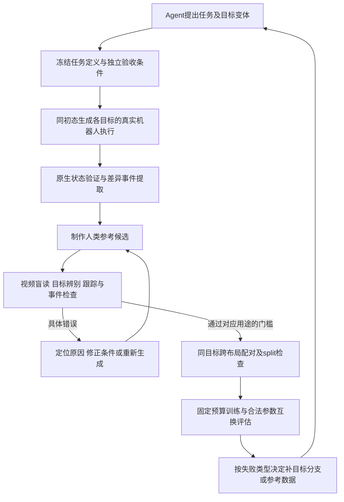

# 从仿真任务分支到可验证的人类参考：完整链路设计

日期：2026-10-19。状态：代码/数据审查后的设计稿；不是已经搭完的生成服务，没有新生成、采集或训练结果。本轮只读本地代码、manifest、部分NPZ字段及3条媒体的ffprobe信息，并核查一手资料。

## 1. 核心判断与可声称的贡献

目标应是：在同一个机器人可观测状态下，不同参考明确要求不同合法行为；跨本体视频转换保留这种区别；最终更换参考生成的策略参数，机器人行为也相应改变。

漂亮的视频、VLM高分、W范数变大、从W读出腕部轨迹，分别都不足以证明这一目标。更好的数据工厂应维护“任务选择→生成参考可见证据→实际策略行为”三者的一致性。

Zero-WAM已做机器人任务分析、首帧编辑、语义人类视频生成、VLM筛选；其IFP也试图让机器人主分支承担参考相关预测。因此“合成人类参考+未来预测辅助”不是我们的新贡献。其公开方法没有提供逐帧运动、接触或物性保持保证；允许场景变化本身是合理的数据扩增，不能简单判成缺陷。[Zero-WAM §2.2、§3.3](https://arxiv.org/html/2608.26103v1)

潜在研究价值是把三件事连起来并独立验证：可辨别的任务分支、保留任务差异的跨本体生成、参数变化导致行为切换。各组件有先例，不能未查证就称首创；更不能由合成视频推断学到了物理规律。

## 2. 已有基础和真实缺口

| 项目 | 本轮读到的事实 | 尚不能声称 |
|---|---|---|
| 同初态多目标资格集 | 8组×3目标=24条；四种初态hash及互斥终态目标的构造审计已存在，另有24个跨布局参考fixture | 模型已经使用参考或W；该报告明确未测模型成功率 |
| 正式长程发布 | 319条/107布局；train199、validation60、test60；105组有全部3目标，2组缺一个；human_pairs=0 | 107组均完整，或319条均有合格人类参考 |
| 三类长程程序 | 取中层并恢复，3个搬运阶段；取底层并恢复，5阶段；反转堆叠，6阶段；有实际支撑/访问依赖 | 完整真人Jenga任务、丰富真实几何；目前仍是刚性块代理 |
| 现有R2H输入 | 苹果、书、柜门各2条，CPU媒体准备已完成 | 已接通上述多目标组，或已有合成人类输出 |
| 几何记录 | 有物体/机器人实测状态、接触与时间信息，部分相机与可见性QA | 默认已保存逐像素mask和depth |
| 重放 | 初始化过程中内存保存/恢复物理及控制器状态，落盘有初始物理状态 | 完整跨进程精确重放包；控制器/RNG/求解器缓存未全部落盘 |

来源：[多目标构造审计代码](../PolicyGen/examples/baselines/hypericl_data_factory_expansion/long_horizon/reference_necessity_v1.py)、[任务程序](../PolicyGen/examples/baselines/hypericl_data_factory_expansion/long_horizon/programs_v2.py)、[24条审计](/mnt/sdf/datasets/hypericl_data_factory_20261017_expansion_v1/long_horizon/clearance_complete_qualification_handoff_v1/reference_necessity/report.json)。

正式发布证据：[approval.json](/mnt/sdf/datasets/hypericl_data_factory_20261017_expansion_v1/long_horizon/retained319_release_v1/approval.json)、[policy_rows.json](/mnt/sdf/datasets/hypericl_data_factory_20261017_expansion_v1/long_horizon/retained319_release_v1/policy_rows.json)。本轮未重新解码全部319条，接受数量来自已存发布证据及manifest计数。

本轮抽查seed860174000的3条原生视频：取中层61.70秒、取底层98.05秒、反转114.85秒，均20FPS。同组命令首次分歧分别在28.75秒、57.20秒附近。这些是抽查例子，不是全库时长范围。上一轮准备的6条普通R2H输入为15–25.2秒，不能把它们的API适配结论直接套到真正多目标长程数据上。

## 3. 机器人视频与人类参考之间究竟差什么

1. **任务含义**：搬哪一个、去哪里、几次、什么方向、什么顺序，以及哪些对象不能动。
2. **任务必要步骤与机器人实现细节**：人可以一次托起两块上层积木，机器人可能必须逐块移开；两者都可能合法。只有任务本身要求的顺序应强制一致，机器人路径、等待时长、重抓动作不应全部强加给人。
3. **接触与本体**：TCP在夹爪中间，腕部在手掌后方；机器人两指和人五指的接触、遮挡、可达性不同。只把机械臂外观涂成人手会产生空抓、穿透、错误腕部位置。
4. **时间与视角**：机器人视频的长等待不等于任务含义；相机改变又会改变图像左右与旋转方向。时间压缩、裁剪、镜像都可能改变顺序、次数或方向标签。
5. **对象身份**：颜色可以是合法任务条件，也可能只是数据偏差。跨外观生成必须保存对象角色映射，不能让“红杯”无声变成“任意杯”。
6. **事实可信度**：仿真有状态和动作真值；生成RGB只有可观察证据。生成器可能改变物体运动，不能沿用原机器人动作作为人类动作，也不能把生成手的估计位姿称为测量真值。

因此定义两个不同的合格等级：`task_equivalent`保留目标及必要事件；`motion_verified`进一步满足声明的运动/时间/相机约束。不能通过一个“物理合理性总分”混成同一种数据。

## 4. 统一链路



### 4.1 任务定义是可执行约束，不只是一段prompt

每个任务至少记录：

```yaml
task_family: supported_stack_rearrangement
goal_variant: retrieve_middle_restore
initial_group: immutable_scene_group
roles: [bottom_block, middle_block, top_block, temporary_support, destination]
initial_relations: [top_on_middle, middle_on_bottom]
goal_predicates: [middle_at_destination, top_supported_by_bottom]
necessary_precedence: [clear_support_before_access]
allowed_realizations: [one_hand, two_hands, different_grasp_and_speed]
forbidden_outcomes: [wrong_object_removed, unsupported_final_object]
preserve_across_embodiments: [target_identity, required_relations, required_order]
allowed_variations: [appearance_if_roles_preserved, camera_if_direction_remapped]
reference_scope: whole_task
supervision: [robot_action, reference_goal]
human_3d_ground_truth: absent
```

这是字段示意，不是现有代码已兼容的schema。对象的度量阈值、时间容忍和稳定条件由各任务定义，按实物尺度校准，不写统一的毫米精度承诺。

区分任务必要的偏序与当前脚本选定的全序。Agent可提出更自然的人类实现，但不能私自改变目标和必要条件。若设计目的就是模仿特定顺序，顺序才作为任务要求进入契约。

### 4.2 机器人端先保证任务事实

保留现有原生执行和独立验证，补充适合转换的观测导出：RGB/PTS、相机K及外参约定、对象ID mask、机械臂mask、depth、对象位姿、机器人控制与实测运动、接触事件、阶段及结果。

同组不同目标应核验所有策略可见输入一致：初始RGB、proprio、dt、本体信息；目标不得通过环境reset、初始准备动作、背景、文件名或隐藏task ID进入策略。四hash是已有好的起点，但要进一步覆盖实际reader消费的字段。

若需要恢复中间决策状态，先建立可验证的重放方案。不能把当前初始物理状态文件冒充完整控制器与物理求解器状态。重放后检查实测状态与渲染偏差；失败则重新原生执行，而不是拼贴状态。

新资产/布局用对象相对技能和重新规划生成候选，再执行验证。MimicGen已有对象中心子任务和阶段接口，适合借鉴；变换轨迹不等于必然成功。[官方接口](https://mimicgen.github.io/docs/tutorials/datagen_custom.html)

### 4.3 专门检查“目标差异是否看得见”

对每组目标，列出区分它们的必要可见事件。例如三类堆叠任务共同先移开顶块，但之后取哪层、恢复什么支撑关系不同。参考必须覆盖这些差异，不能只拍相同的共同前缀。

在生成前检查源参考可辨性，在生成后重做：盲读视频恢复对象角色、事件时间段与目标，再和冻结契约比较。另让审核器在同组候选目标中选择或回答“不足以判断”，候选顺序随机。不给审核器“这段应该是目标A，请确认”这样的提示。

同一首帧下不能辨别目标是预期；完整参考仍不能辨别，才需要重拍视角、增加事件覆盖或弃用。放置任务只看终帧就能读出目标不算作弊，但它不能证明时序理解；另设同初终态、方向/访问顺序不同的诊断任务。

合成时优先给同初态的所有目标复用同一张人类初始锚帧，锚帧生成不读取目标变体；从动作开始后才表达任务差异。人物、背景、相机和生成后端与每个目标交叉分配。这能减少“编辑首帧时已用目标提示改变了人物站位或目标物外观”的泄漏；不能仅使用相似prompt就声称首帧相同。

### 4.4 人类参考生成分三路，按任务选择

| 路线 | 实际操作 | 接受标准与用途 |
|---|---|---|
| 语义重生成 | 原生事件证据→角色一致的初始人类场景→自然人类操作 | 目标、必要顺序、对象身份明确；允许不同抓法/速度。主要用于任务参考 |
| 受控视频编辑 | 原视频+本体mask+人手/角色参考，必要时加入几何控制 | 额外检查非目标区域、运动、事件时序；接受mask的模型仍未必硬性锁定像素 |
| 几何引导人手渲染 | 已知对象运动→人手/上肢IK与接触约束→深度合成→可选外观修饰 | 可提供渲染流的合成3D标签；如写实化改变手部轨迹，旧标签不能自动沿用 |

受控编辑中，本体区域、可能变化的接触/遮挡边界、应保持的背景应分开处理。手和夹爪轮廓不同，不能把mask外原像素生硬贴回就声称接触保真。

对于长程：保留完整原生机器人轨迹；从中提取覆盖完整事件链的证据，制作自然人类速度的语义参考，并记录新的事件时间映射。若确实超出API长度，采用带共享角色、边界帧和对象状态检查的连续扩展；失败就拒收。独立生成片段拼接不能冒充连续物理操作。若只生成阶段片段，就标`partial_task`，不能自动给整段机器人轨迹当完整参考；多片段输入需要另做模型实验。

新模型接口只是候选：Seedance2.5支持4–30秒原视频编辑；VACE提供显式视频/mask/参考图条件。没有证据表明任何接口能无条件保住抓取接触。[Seedance教程](https://docs.volcengine.com/docs/ark/seedance-2-5?lang=zh)、[VACE](https://github.com/ali-vilab/VACE)

### 4.5 验收与纠错必须有明确失败类型

| 失败 | 检测依据 | 处理 |
|---|---|---|
| 机器人原轨迹未真实成功 | 原生状态、碰撞、支撑、终态及日志 | 修规划/资产/控制，重新执行；不能让视频模型修成“成功” |
| 生成视频选错物体/方向/顺序 | 盲读事件、同组目标辨别 | 修角色绑定或重生成关键行为；不能改标签迎合错误输出 |
| 物体消失、复制、突然位移 | segmentation+tracking+关键帧审查 | 重新生成该段或换路线；接触处错误需要上下文检查 |
| 接触被遮挡，无法证明 | 可见性与事件证据不足 | 标unknown，补视角或降为不需要该监督的用途 |
| 长视频段间状态断裂 | 边界对象身份/位置/支撑关系检查 | 连续扩展或重做过渡；不以剪辑掩盖缺失步骤 |
| 腕部标签与写实化视频不一致 | 原rig投影与最终视频对照 | 关闭该视频3D监督；不要沿用过期标签 |
| 同目标始终对应同人物/背景/长度 | 元数据交叉表与简单分类基线 | 交叉采样、补齐缺失组合；保留语义必需的颜色/次数信息 |

先媒体/原生硬检查，再跑批量视觉工具，最后VLM定位和复核。不同VLM也可能共同犯错；要用明确错误的校准样本检查漏检，例如目标替换、缺失释放、顺序颠倒、对象中途消失。不能把所有校准样本混入训练。

Agent负责提出方案、调用工具和总结证据，验收器读取冻结版本任务定义。产生失败样本的agent不得为过关临时放宽阈值。规则确需修订时生成新版本，重审旧样本并记录原因。

所有尝试及有界重试都留账。扩量按稀缺任务分支、成功参考率和下游混淆选择，不只追求漂亮或容易生成的类别；否则又会回到少数任务数量失衡。

### 4.6 配对、split与训练

以源执行A生成参考H_A，再配同精确目标、不同布局的机器人执行B。PolicyNet观察和action全部来自B；H_A只提供目标/程序。A、B及其派生视频必须在同split；划分不只看文件名。原始真实人类参考仍保留为独立评估来源。

同初态多目标训练要覆盖真正的决策分叉，现有长共同前缀不应占据绝大多数训练曝光。可对完整轨迹、分叉邻域、接触/释放阶段分层采样并记录比例；不删除原始共同前缀，也不把两个不同状态仅按归一化进度当作同状态负例。

优先保持当前稳定架构、初始化、动作空间及已有辅助loss不变，只比较配对数据/验收方案。合成RGB的腕部3D loss默认关闭。后续如研究视频采样，单独比较均匀采样与事件覆盖采样；后者不能把真值目标/阶段ID输入评估模型，且需保持帧数/预算可比。

## 5. 为什么W辅助头还不够，以及可选的动作约束

[现有W腕部路径](../PolicyGen/examples/baselines/hypericl_dense/w_motion.py)使用实际W，但将condition置零、bias替换成固定anchor，结构参数冻结。这能检验W是否存有可读出的轨迹信息，不能保证机器人action实际读取相同信息。

更直接的第一步是同观测多目标的原生action监督，不要求W彼此距离大。若仍存在参考依赖不足，才单独比较动作分叉监督。

代码的flow matching定义为`x_u=(1-u)a+uε`，目标速度`v*=ε-a`。低噪声时输入本来含有动作信息，这是标准训练形式，不是已经确认的bug；它提示平均action loss不足以诊断参考利用。[实现](../PolicyGen/examples/baselines/hypericlzq/modules/heads.py)

可选实验：在真实相同观测/状态且动作确有分歧的分叉chunk，给各参考同一噪声ε，在u=1处加少量端点监督：

`L_fork = mean_i ||v(P(H_i), ε, 1, observation) - (ε-a_i)||²_mask`。

此时输入噪声和机器人条件相同，合法目标动作不同，差异须由参考条件解释。普通flow loss保留；端点监督只是待检验的建议，不保证整条ODE采样/闭环行为改善，也不能把单点速度估计当作完整动作生成结果。先做数据对照，再做该loss，避免同时改变多个因素。

只在动作空间、归一化、dt、有效mask和实际观测相同的分叉使用；公共接近动作不强行分离，同目标不同合法路径不互当错误负例。若目标分支由不同robot state开始，本约束不适用。

## 6. 最小有辨识力的实验

| 问题 | 对照 | 需要的结果 |
|---|---|---|
| 转换是否保留信息 | 同一源轨迹/预算：HumanGen式语义生成 vs 增加事件/角色约束与独立验收 | 合格目标辨别率、必要事件完整性、错误率、每条独立合格参考成本；保留全部尝试分母 |
| 多目标数据有无帮助 | 同机器人执行预算，普通采样 vs 分叉覆盖；其他模型设置不变 | 同初态不同目标的按目标成功率提升；不是只看任意一个目标成功 |
| 参数是否传递任务信息 | 同初态/同动作噪声，从合法参考A/B分别生成完整P=(W,b)并互换；同目标换人物/风格 | P互换后执行目标改变，同目标换外观仍稳定 |
| 是否需要时间信息 | 完整有序参考 vs 首尾帧/打乱帧，等帧数等预算对照 | 在真正时序任务上出现有解释的差异；简单目标任务不强求差异 |
| 是否只是生成器风格适配 | 另一生成来源、真实人类新会话、未见布局及组合 | 收益迁移；若只合成→合成有效，则限制结论 |
| HyperNet是否有必要 | 同视觉特征、容量、更新预算，对比向量条件/FiLM或cross-attention；各组均允许缓存参考 | 参数生成在组合泛化、稳定性或运行开销上有明确收益；不能只拿弱条件网络作对照 |

评估必须确认参考唯一经P进入动作分支；若仍有参考特征旁路，需控制后才归因于P。当前dense有reference_only及observation_phase模式，实验需要明确固定哪一种。首轮建议reference_only，按一次参考生成参数的协议运行。

平均W是补充诊断：均值可能离开合法策略参数分布。主要证据是两个各自合法、同协议生成的P互换。若声称W而非bias承载信息，再专门做W/b交叉，但需说明其潜在分布外问题。

对于K个均衡且成功条件互斥的目标，如果机器人初态完全相同、没有其他目标信息，参考无关策略平均最多正确选择1/K。这个界限仅适用于上述受控集合，不能套到任意任务库；W互换成功证明参考影响行为，仍不自动证明抽象程序组合或物性理解。

## 7. Agent与工具各做什么

| 组件 | 用途 | 边界 |
|---|---|---|
| 任务设计agent | 维护任务/角色/必要事件，寻找未覆盖的目标分支 | 不能凭语言造物理事实，也不能用任务名代替可见信息 |
| 现有SAPIEN/ManiSkill runner及MPlib | 真正执行并产生动作、状态和失败证据，补原生depth/mask | 不用逐帧agent控制代替成熟运动规划；先复用已有验证器 |
| MimicGen / cuRobo（按需） | 对象中心技能扩增、IK与碰撞路径候选 | 不是默认替换当前MPlib；需要任务接口和当前环境适配，避碰路径不保证抓取成功 |
| SAM 3/3.1 | 合成视频中手、对象的分割及跨帧身份候选 | 原仿真直接使用真值mask，不重复估计；分割结果有错与遮挡 |
| CoTracker3 | 跟踪对象/手的可见点，定位跳变与不连续 | 2D跟踪不是接触力，也不是米制3D真值 |
| VLM审核agent | 盲读事件、对象角色、顺序及不确定性，返回帧证据 | 不接受一句“物理合理”；与生成prompt隔离，允许unknown |
| FFmpeg/ffprobe、JSON/SQLite索引 | 媒体时间、任务状态、输入输出hash、成本与重试账本 | 先用简单可恢复的队列；无需一开始搭复杂分布式服务 |
| 修复agent | 根据错误码调整源视角/角色绑定/生成条件 | 不能改原机器人动作、验收GT或用剪辑隐藏任务失败 |

工具官方来源：[MimicGen](https://mimicgen.github.io/docs/tutorials/datagen_custom.html)、[cuRobo](https://nvlabs.github.io/curobo/latest/api/curobo.motion_planner.html)、[SAM3](https://github.com/facebookresearch/sam3)、[CoTracker3](https://github.com/facebookresearch/co-tracker)。这些是候选工具，没有在本轮安装或接入。SAM3.1已在官方仓库发布；不需要为“最新”替换当前可用组件。

当前规划与观测优先复用[MPlib](https://motion-planning-lib.readthedocs.io/latest/)及[SAPIEN相机/深度/分割](https://sapien-sim.github.io/docs/user_guide/rendering/camera.html)。接口升级须与现有安装版本匹配，不将新版文档直接当成本地API行为。

不把单目深度/人手重建默认作为硬真值来源。Phantom/Masquerade也区分了RGBD动作标注与单目2D辅助。[官方说明](https://github.com/MarionLepert/phantom)。接触与遮挡方法可借鉴，但估计几何不是力学测量。[接触保持论文](https://arxiv.org/html/2610.06137v1)

## 8. 物理理解必须另有可辨识实验

同一个物理状态s、相同动作a、相同物理条件θ，仅任务目标g变化，真实下一状态不应随目标变化：

`p(s_next | s,a,θ,g) = p(s_next | s,a,θ)`。

因此不能强迫不同任务参考在相同物理条件下预测不同真实物体响应。人类语义重生成也不建立真实力、摩擦或质量标签。

以后若研究物理，应独立构造参考中可观察的物性差异，以及与执行域可信的映射；区分目标信息、几何可供性和隐藏物性。人手施力不可知时，仅见物体位移一般不足以唯一识别质量/摩擦。当前最扎实的第一篇叙事应先落实目标、顺序和参考控制行为，物理机制另设证据，不混作已经证明的效果。

## 9. 推荐实施顺序

1. 固定上述契约/事件证据/失败分类，接通已有24条构造审计与319条正式split。资格样本可作开发检查，不能未经划分自动混入正式训练/测试。
2. 对已有6条普通源视频做接口/媒体可行性验证；它们只能校准转换质量，不能代替同初态多目标实验。
3. 在正式train或validation中选少量完整三目标组，先验证长视频事件信息如何进入生成条件；补必要mask/depth及可靠重放，或直接用语义路线。生成每个目标的人类参考，人物/背景/后端与目标交叉分配。
4. 批量验收后展示同组机器人、人类、事件证据和失败例。先解决信息丢失，再按任务覆盖扩量。
5. 最后在固定机器人数据与更新预算下训练；先不加新loss，做合法P互换、真人参考及组合泛化。若有明确剩余问题，再做分叉action loss与HyperNet结构对照。

下一步接口需求可收敛为一个能视频理解并输出结构化证据的VLM，以及一个支持视频编辑/多模态条件的视频生成API。先固定一套可比较协议，不需要同时接入所有模型。当前没有发送视频或调用付费接口，也没有恢复暂停的采集/训练。
