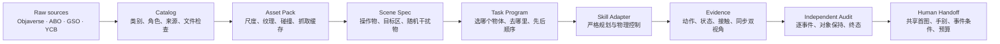

# 资产扩量与同场景多任务工厂

2026-10-26 候选版本。入口为 `scripts/run.sh assets` 和 `scripts/run.sh tasks`，默认生产机制及旧验收器不变。实际结果见 [本轮记录](../validation/asset_scaleup_20261026/RESULTS.md)。

原来的 28 个是人工选取后加工的小样本，不是本地资产总量。本轮把 58,117 条原始记录接入可检索索引，并实现按需加工和缓存。现有最终候选目录为 `assets/expanded_library/scene_catalog_v3.json`，含 258 个不同来源 ID，其中 256 个允许作为静态干扰物。这个数字不代表 256 个能抓取的资产，也不代表所有语义类别已经视觉确认。

## 从资产到任务的结构



核心分离是：**物体、场景、任务程序和接触技能各有独立定义**。一个新杯子不需要新的搬运脚本；同一场景的多个目标也不需要重新写控制器。但“搬杯子”与“把杯中液体倒出”需要不同的物理状态、技能和验收。

| 层 | 输入与输出 | 触发、失败行为及开销 |
|---|---|---|
| 原始索引 | 本地 JSONL → SQLite/FTS；来源、类别、文件、哈希、分区 | CPU 一次建索引；元数据只是候选，缺文件、超大输入、非网格会拒绝 |
| 角色加工 | 候选 → 自包含 GLB、尺度、稳定朝向、碰撞描述 | 静态干扰物采用保守包围盒；操作物保留既有 3 mm 几何与原生碰撞复查；有超时、存储、并发上限 |
| 按需取物 | 类别/角色/数量/尺寸 → 已有资产绑定与缺口 | 优先复用；只有显式 `--prepare-missing` 才加工缺口；有限候选失败后返回不足，不无限补抽 |
| 抓取缓存 | 操作候选网格 → Panda 可行几何抓取候选 | CPU 离线；空缓存会阻止物理执行；不因为想凑数量而缩小物体或放宽检查 |
| 场景生成 | 两个操作物、两个目标托盘、随机种子 → 同一个 SceneSpec | 3–8 个不同干扰物；随机种类、位置、朝向；操作物位置与姿态也随机；有限布局搜索失败会留下记录 |
| 任务程序 | 对象角色、目标位置、操作先后 → TaskProgram | 当前每场景最多生成本文列出的 5 个程序；不能凭名字注册新技能 |
| 执行与验收 | 程序 → 动作/状态/接触/双视角/逐事件结论 | 单 GPU 串行；已有进程与共享锁保护；失败和未知执行都占预算，不自动重试 |
| 人类视频接口 | 合格执行 → 合同、条件、共享场景首图键、来源绑定 | 已真实运行零调用预检；收费生成需要另一个有限累计预算，本轮未生成新视频 |

## 快速使用

以下命令全部从仓库根目录执行。已加工目录和抓取缓存随候选分支提供，不需要原工程或原始资产库。**再扩充尚未加工的原始资产**，才需要自行提供源库及其 JSONL；索引里的旧机器路径不是可下载地址。

检索与按需取物：

```bash
scripts/run.sh assets search \
  --index assets/expanded_library/raw_roles_v4.sqlite \
  --category bottle --role static --limit 10

.venv/bin/python scripts/resolve_task_assets.py \
  --catalog assets/expanded_library/scene_catalog_v3.json \
  --output runs/my_asset_request \
  --role static --category bottle --category utensil \
  --count 12 --max-dimension .18 --partition development
```

如确需补库，在同一请求中加入 `--prepare-missing --preparation-limit 8 --workers 2 --timeout 120 --disk-mib 512`。每个请求使用新目录；未知的已有加工任务先恢复查询，不重复提交。

从两个新操作网格生成一个场景、五个不同目标：

```bash
scripts/run.sh tasks init --root runs/my_scene_tasks \
  --catalog assets/expanded_library/scene_catalog_v3.json \
  --cache-index assets/expanded_library/grasp_cache_v1/development_index.json \
  --cache-index assets/expanded_library/grasp_cache_v2/development_index.json \
  --recipe configs/task_recipe_fruit_block.json \
  --scenes 1 --physical-limit 5 --gpu 2 --seed 9271

scripts/run.sh tasks run --root runs/my_scene_tasks --limit 2
scripts/run.sh tasks audit --root runs/my_scene_tasks
# 检查小样结果后再运行该计划剩余任务；终态已登记的尝试会跳过。
scripts/run.sh tasks run --root runs/my_scene_tasks --limit 3
scripts/run.sh tasks audit --root runs/my_scene_tasks
```

GPU 编号必须是实际空闲设备。新代码会拒绝已有 GPU 作业；不会停止训练。`init` 只写输入与冻结计划，`run` 才执行。一个场景两种来源相同但布局不同，仍共享来源分组；同场景全部派生任务不能跨训练/验证划分。

当前五个程序为：

1. `select_0`：只搬物体 A，保持 B 不动。
2. `select_1`：只搬物体 B，保持 A 不动。
3. `clear_pair`：将两个物体分别移到各自托盘。
4. `arrange_pair`：将两个物体摆放到指定桌面位置。
5. `ordered_pair`：先搬 B、再搬 A，并验证显式先后约束。

这包括选择、清理、摆放和顺序要求四类程序组合，底层仍是一种 `pick_place` 接触机制。不能报告为五种新的接触机制，也不是双臂同时抓取的新验证。

新任务的日常配置形如：

```json
{
  "schema": "resimpair_task_recipe_v1",
  "role_queries": [
    {"role": "fruit", "categories": ["fruit"], "required_skill": "pick_place"},
    {"role": "block", "categories": ["toy"], "required_skill": "pick_place"}
  ],
  "families": ["select", "clear", "arrange", "ordered"],
  "partition": "development"
}
```

参数仅声明候选需求，不保证语义、抓取或任务成功。名称含 `Orange` 的鞋不能变成橙子，`12 Pack Cans` 也不能当成一个罐子。现有规则修复了已发现的部分歧义；复杂标题和真实外观仍需额外证据。已知歧义在角色查询中不能自动取得操作资格。

## 怎样继续扩任务

**增加资产和布局**：经角色加工的资产进入数据目录，现有技能即可复用。不要为每个新物体复制控制脚本。按任务缺口取物，避免一次加工几万个永远不会用到的模型。

**增加目标组合**：在程序编译器增加有明确语义的目标与约束，例如按指定顺序归位、选择子集、不同区域分类。必须先定义非目标物保持、目标关系和事件验收；增加同一动作的颜色变体不计新机制。当前实现仅支持两个操作物、每个物体一次搬运；多次搬同一物体需要扩展事件窗口，现入口明确拒绝。

**增加接触机制**：实现并登记技能包，而不是添加任务字符串。技能包需要资产接口、前后条件、控制器、状态/接触导出和独立检查。例如插入需要配合孔/轴、容差和插入深度；开合需要关节轴、行程、把手与限位；倒出需要容器内腔和内容物流动状态。仓库旧机制的控制与检查可以复用，但要把它们接入这一资产角色接口后才算完成。这次新增的工厂对 `insert/pour/articulate/stack` 仍会拒绝。

**控制覆盖和资源**：下一步宜让采样器优先补“资产 × 尺寸 × 布局 × 目标关系 × 技能”的空缺，每个来源记录已尝试与失败原因。现有版本已保存这些证据和有限采样预算，尚未实现自动选择最有价值样本的调度器。

## 已知限制

- 资产尺度和质量是预先确定的工程假设，不是恢复出的真实物理参数；按最大边缩放不能代替实际尺寸标注。
- 静态保守碰撞体只适合避障和工作区外干扰，不能作为容器内腔、抓取界面或承载面的证明。
- 现有俯抓器对宽、扁、低矮物体有明显覆盖缺口；应研究其他稳定放置姿态、侧抓与联合抓取/放置规划，不能简单无限换 seed。
- 修复了 GSO 纹理路径，但“纹理存在”不等于“商品名称正确描述了可操作对象”。本轮保留原生渲染与明确的语义 unknown。
- 新网格的人类视频还未收费验证；共享首图预检、物理成功与正式真人来源配对分开统计。
- 这是候选版本。原始失败、旧索引、旧目录、旧规则都保留；冻结实验应使用自己的 `release/` 源码，不能让后来修改的源码冒充当时版本。
