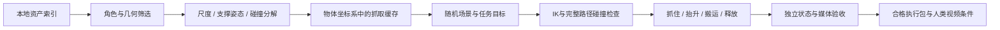

# 资产整理与通用抓取候选管线

这是独立仓库的可运行候选入口。保留原默认管线，通过 `scripts/run.sh grasp ...` 启用。实际对照、失败和版本决策见 [实验结果](../validation/generic_grasp_20261026/RESULTS.md)。不把“有模型文件”“有抓取候选”“物理执行合格”混为一谈。

## 已接通的路径



- **索引与角色**：本地 58,117 条原始索引包含模型、纹理及场景定义，不等于可操作资产数量。SQLite 索引用于导入检索，运行新实验只依赖仓库内的加工资产。按类别、最大尺寸、用途筛选；静态干扰物不会因名称匹配而自动获得操作资格。
- **资产加工**：将原纹理保存为独立 GLB；保存原文件哈希、来源许可、显式工程尺寸和质量。近凸几何使用有误差记录的凸包，其他候选调用 CoACD。空腔、容器支撑和关节功能不因生成凸包而自动成立。尺寸和质量不是从视频恢复出的真实物理标定。
- **碰撞一致性**：缓存 PhysX 实际烘焙网格，再做新进程复读检查。运行中导出实际 collider、尺度、局部变换、密度和质量，独立验证。几何不一致即拒绝，不扩大阈值。
- **抓取缓存**：使用固定提交的开源 `grasp-sampler` 表面对向接触采样。缓存包含多个物体局部 TCP 位姿、开口宽度和排序信息。网格、尺寸、Panda URDF/手爪网格、后端参数、代码版本共同绑定；运行时通过物体实测位姿变换到世界坐标。先尝试最多 12 个几何/IK 候选；只进行一次物理抓取，不隐藏失败重抽。
- **场景多样性**：源物体 XY、目标位置和 yaw 随机化；从不同类别优先抽取 3–8 个不同网格干扰物，随机摆放。尺寸过大的资产被筛掉，采样时避开操作区域，运行前仍检查实际全臂与携带物路径。每个初始场景登记托盘放置、桌面重定位两个任务。
- **控制**：沿用严格规划入口的官方 MPLib 初始化、加密插值、FK 和几何检查。每段检查全臂、另一机械臂、完整桌面、全部障碍物及实际携带物。打开的手指在接近目标时不得碰撞目标；夹紧后要求真实双指接触。抬升从夹紧后的实测 TCP 开始，释放前检查实测位置和抓持状态。
- **输出**：动作、物体状态、接触、双相机 RGB、原生时间轴、相机标定、阶段计时、任务协议、失败原因。两路视频属于同一次执行，不计为两条新动作。
- **下游**：合格执行包可交给现有冻结版人类视频执行器。首图、单人和手归属检查继续使用已有规则；没有真实视频来源时保持 `synthetic_only`。本轮验证了执行器的真实预检路径，未生成新的人类视频。

## 使用已有加工资产

```bash
# 按任务角色与尺寸筛选。返回的 qualification 必须继续读取。
scripts/run.sh grasp select --catalog assets/grasp_library/v2/catalog.json \
  --role rigid_manipulation_candidate --category bottle --max-dimension 0.16

# 新建有限物理预算的实验；GPU 必须空闲。所有 API 上限为 0。
scripts/run.sh grasp init --root runs/my_grasp_trial \
  --catalog assets/grasp_library/v2/catalog.json \
  --cache-index assets/grasp_library/grasp_cache_v3/development_index.json \
  --gpu 2 --layouts 2 --physical-limit 24

# 初次只执行两个登记案例；无候选的案例在物理执行前拒绝并计入尝试分母。
scripts/run.sh grasp run --root runs/my_grasp_trial --limit 2
scripts/run.sh grasp audit --root runs/my_grasp_trial
```

每次运行检查 GPU 进程和共享锁。已有 reservation 而无 terminal 的案例必须先恢复现场，不能重新提交。每个物理执行有 300 秒超时；未通过的尝试及超时也占物理预算。`--limit` 控制本次最多处理的登记案例数量，预检拒绝单列，不能算成物理成功。

将合格案例交给现有人类视频执行器，先做零调用预检：

```bash
.venv/bin/python scripts/prepare_grasp_human.py \
  --source runs/my_grasp_trial --output runs/my_human_handoff \
  --case <cohort.json中的execution_id>
```

该命令实际调用已有冻结执行器验证完整合同、两路媒体、手归属和预算接口。收费生成需要另建有明确额度的生成实验，不能修改已保留的零预算账本。已有的持续 API 授权仍有效，不需要逐条重新许可。

## 导入更多资产

```bash
# selection 每项为 [原资产ID, 类别, 工程最长边m, z_up或stable, 数据分组]
scripts/run.sh grasp prepare --index /path/to/raw/catalog.jsonl \
  --selection configs/grasp_asset_selection.json --output assets/grasp_library/new_import \
  --timeout 120
scripts/run.sh grasp refine --catalog assets/grasp_library/new_import/catalog.json \
  --output assets/grasp_library/new_refined
scripts/run.sh grasp cache --catalog assets/grasp_library/new_refined/catalog.json \
  --output assets/grasp_library/new_cache --partition development
```

每个导入资产最多 120 秒；失败保留在 catalog 分母里。已有目录不可覆盖。新资产不需要写独立的抓取搬运脚本，但仍需要可靠的类别、用途、尺度与支撑姿态说明。当前选取清单是显式工程输入，不能宣称已经自动理解了所有原始资产。

## 验收与版本边界

验收器 `resimpair_grasp/evaluator.py` 在实验开始前绑定哈希。复用原任务事件、稳定性、接触与 FK 标准，额外验证原生 collider 和完整双视角时间轴。生成器不能修改同轮阈值。路径检查沿用 0.015 rad 加密、2 mm 终点位置阈值；这是离散加密验证，不是连续时间的形式化证明。

本轮发现安装的 MPLib 0.1.1 在非零基座平移下计算附着网格碰撞时漏掉基座变换。保留复现；候选分支在每个加密点用世界坐标的实际携带物 BVH 检查，不依赖该错误附着几何。官方机器人/自碰撞检查仍保留。完整桌面只允许起始抬升 2 mm 内、深度不超过 1 mm 的支撑接触。

保留验证的操作资产不进入开发场景的操作或干扰物池；原有独立静态干扰物池可以共享。相同真人来源、初始场景、物理执行及其相机/目标派生保留分组，不能跨训练与验证集制造独立样本数。

当前范围是刚体平行夹爪抓放。扁平宽物体、窄可达区、抓取后滑移、复杂薄壁碰撞分解仍可能失败。其他夹爪、灵巧手、插接、形变、容器内部支撑不能直接继承本轮资格。广泛批量默认晋级需要更大的冻结验证集，不能根据这批通过案例自动宣布完成。

仓库附带一条真实执行的状态、接触、几何和双相机证据，可在没有历史 `runs/` 的机器上重放验收故障回归：

```bash
.venv/bin/python scripts/check_grasp_evidence_faults.py \
  --execution validation/generic_grasp_20261026/portable_regression_fixture/execution \
  --output runs/my_fault_replay
```

该检查先确认未修改的状态与媒体通过，再分别注入终点错误、抓持缺失、机械臂碰撞、干扰物移动、TCP 坐标错、关节越限、碰撞网格改变和相机缺帧，要求现有验收器拒绝。原样证据和迁移哈希在 `PROVENANCE.json`；只做 CPU 证据回放，不启动物理仿真或收费 API。

## 第三方组件

实际使用 [grasp-sampler](https://github.com/ShirakuGIT/grasp-sampler/tree/4a3c8fae876d2abe8488ec9d6dd9916d3afeec1f) 的 NumPy/trimesh 对向接触采样，许可证和原始提交记录在 `third_party/grasp_sampler/`；[CoACD](https://github.com/SarahWeiii/CoACD) 用于凸分解。参考 [GraspVLA](https://arxiv.org/html/2505.03233v2) 的“先生成抓取、再做物理验证”思路，但这里没有复现或宣称使用其 BODex 优化器，也没有安装 GraspDataGen 的整套 IsaacLab 环境。
