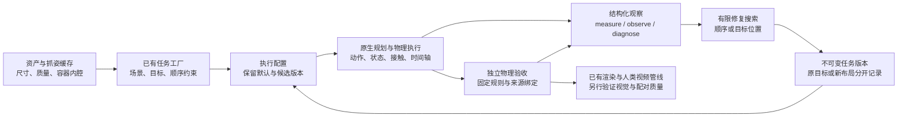

# 场景操作与修复接口 v1

2026-10-31。实现入口为 `scripts/scene_tools.sh`，Python 包为 `resimpair_scene`。这是接在现有 ReSimPair 后端上的功能层：仍使用已加工资产、cuDex 缓存、原生碰撞规划、SAPIEN/ManiSkill 和独立验收器。

## 架构改变

过去需要分别读任务 JSON、运动日志、测量数组和验收文件，再手动写新的实验脚本。本接口把这些操作变成有界、可重复调用的函数，并把执行器版本从业务调用中分离。



参考 SimScene 的“测量—操作—观察”接口组织方式，未安装或替换为 SimScene。当前提供 Python、命令行和本地 JSON-lines；**不是 MCP 服务**。不新增模型调用，也不要求 agent 逐帧控制机械臂。

## 已接通的功能

| 接口 | 输入与作用 | 输出与失败行为 |
|---|---|---|
| `scene_measure` | 场景或执行目录，可指定帧/对象 | 尺寸、质量、初态或实测位姿；缺少证据保持 unknown |
| `run_status` | 执行目录及独立审核文件 | 分开报告进程、物理、RGB、人类配对；进程结束不能代替物理通过 |
| `run_observe` | 执行目录，可指定操作或帧 | 有界状态、抓取/接触和事件记录，不加载全视频或稠密分割 |
| `run_diagnose` | 同上 | 具体失败类型、发生阶段、关联对象与证据；不把推断当成已证实原因 |
| `repair_propose` | 已保存的真实下放碰撞失败 | 从实测夹持姿态重建碰撞检查，提出有限候选；不运行物理，不声称成功 |
| `scene_apply_revision` | 候选文件及候选 ID | 新场景/任务/来源合同和父版本绑定；不覆盖旧样本 |
| `scene_apply_release` | 已绑定任务、操作 ID、明确释放方式 | 创建只改变指定操作释放方式的新版本；不改物体、场景和最终目标，原合同不允许低落放时拒绝 |
| `execution_profiles` | 无 | 保留默认 v4 与显式候选 v6/v8，以及混合释放 `task_release`（原 v2）的代码绑定 |
| `campaign_status` | 已登记活动目录 | 区分已分配、已提交、已终态、状态未知及余量 |
| `execution_prepare` | 已登记活动、场景任务、配置名 | 冻结调用意图并占用原额度；重复、绑定冲突或额度不足则拒绝 |
| `execution_run` | 已准备批次与明确次数上限 | 调用原执行器的锁、超时和提交账本；未知提交先恢复，不重试 |

观察功能读取现有数据。修复搜索默认最多24个原生路径候选、90秒搜索窗口；单个底层求解调用不可抢占，时间检查发生在候选之间。当前仅支持已保存的多物下放碰撞，最多8次搬运，不是所有失败的通用修复器。执行的成本和超时来自活动原配置，本轮上限480秒/物理尝试、1个worker。

## 修复范围

**已放物挡路：** 用碰撞记录找出阻挡物对应操作，将被挡的放置提前；保留所有物体、精确目标和必须满足的先后约束。有约束冲突就拒绝。新的顺序也可能引入其他碰撞，必须完整重新执行。

**手掌碰容器：** 搜索容器可放区域内的小幅落点变化。先保留原来的内腔边距和目标物间距要求，再对实测夹持变换执行原生手掌/载物碰撞检查。改变目标坐标必须记录为 `new_related_layout_task`，不能计成原精确目标的修复成功。

两个坐标系统明确区分：编译任务的 `target.offset_xy` 是世界 XY 下相对容器原点的偏移；来源合同的 `offset_xy_m` 是容器局部坐标下相对内腔中心的偏移。修订时同时更新对应合同，不能直接复制数值。

**尚不支持自动修复：** 薄物刚开始抬升时脱抓、任意倾斜资产的稳定抓取、任意接触机制、任意任务的全局最优顺序、背景真实性、人类结构与视频连续性。诊断可以指出部分问题，不能替代这些功能的实现与验证。

## 使用

从仓库根目录运行。以下查询均不提交物理或收费 API：

```bash
scripts/scene_tools.sh tools
scripts/scene_tools.sh campaign runs/production_integration_20261030_v1

execution=runs/production_integration_20261030_v1/final_metric_groups_closure_r1/executions/metric_group_63301d78de427f1d55784def45a53738_distribute_groups
scripts/scene_tools.sh measure "$execution"
scripts/scene_tools.sh observe "$execution" --operation transfer_6
scripts/scene_tools.sh diagnose "$execution" --independent-audit validation/paired_assets_20261030/independent/final_metric_groups_closure_r1/FINAL_REVIEW.json
```

创建修复候选和任务版本也不启动物理；输出目录必须是新目录。将下面占位的候选 ID 换成实际返回值：

```bash
scripts/scene_tools.sh repair "$execution" --output runs/my_scene_repair/proposals \
  --maximum-candidates 24 --maximum-seconds 90
scripts/scene_tools.sh apply --proposals runs/my_scene_repair/proposals/proposals.json \
  --proposal-id '<返回的候选ID>' --output runs/my_scene_repair/revision
```

通过原活动额度执行独立版本；先核对上述 `campaign` 输出，不能新建目录重置预算。修订目录中的 `case.json` 可直接作为输入：

```bash
scripts/scene_tools.sh prepare --campaign runs/production_integration_20261030_v1 \
  --name my_scene_repair --cases runs/my_scene_repair/revision/case.json \
  --profile conditional_descent
scripts/scene_tools.sh run --cohort runs/production_integration_20261030_v1/my_scene_repair --limit 1
```

上述只是命令示例，不表示额外提交已自动安排。默认配置仍为 `checked_withdrawal`；`contact_latch`、`conditional_descent` 是显式候选，单次成功不会改变默认配置。同一配置不能靠换目录重跑同一场景任务；跨配置对照须显式选择并消耗累计额度。

agent 或其他程序可直接调用同一 Python API，也可用 `scripts/scene_tools.sh serve` 逐行输入 JSON：

```json
{"id":"profiles","method":"execution_profiles","params":{}}
```

返回为 `{"id": ..., "result": ...}` 或 `{"id": ..., "error": ...}`。API 只允许列出的11种操作；所有外部服务凭据都不属于观察数据。

请求参数和 CLI 输入文件上限1MiB，结果部分上限2MiB。若有副作用的操作已经返回、但结果过大，接口返回 `operation_returned_result_omitted`、恢复路径和 `do_not_resubmit=true`，不会把完成的操作表示为提交失败。查询或运行失败仍需按保存的状态恢复；不能据响应大小判断物理质量。

## 2026-10-31 追加：按操作选择上方释放

`task_release` 使用已有 `production_integration_v2`，复用实测夹持变换、边沿上方释放和逐操作完全张爪机制。它不是在 v4/v6/v8 上打开一个布尔开关：后三者的检查式撤手只接受 `supported_place`，接口会在分配/提交前明确拒绝混用。已冻结的旧实验配置须原样恢复；仅执行器模块名相同而 `full_open` 等配置不同，不表示可以直接接管执行。

以下只准备不可变输入，不启动物理：

```python
from resimpair_scene.api import call
revision = call("scene_apply_release", {
    "case": "runs/my_input/case.json",
    "operations": ["transfer_0"],
    "mode": "drop_from_above",
    "output": "runs/my_release_variant",
})
```

使用返回的 `case.json` 和 `--profile task_release` 准备实验。只允许原合同已经明确支持的非易碎低落放，保留原最大落差、最终位置、稳定性、接触和非目标物规则。物体底部高边沿3cm并不等于总下落距离3cm；深容器还需要计入内腔深度。未指定的操作保留原释放方式。

真实小样为一个保留的三物收集场景：锁采用上方释放，纸盒和柠檬保留贴近放置，3/3操作通过原独立规则。锁开爪前物底高边沿29.14mm，最终XY偏差4.17mm，CPU执行46.64秒；原任务46.84秒，不能据此宣称提速。只新增一次物理执行，未生成RGB或人类视频，未证明所有任务受益，也未修复另两个7/8物任务。证据为 [独立实测对照](../validation/architecture_20261031/mixed_release_r1/ACTUAL_COMPARISON.json)。历史试验曾出现全部改落放的退化，默认配置不变。

## 验证与版本决定

本轮使用两个已知失败场景：7物的手掌碰容器，8物的手掌碰已放物。先冻结两个方案，再在同一 v8 配置下运行2条原任务和2条修订任务，保留全部失败。8物案例曾属于保留资产集，但本轮已用于诊断，属于修复实验，不能当全新未见验证。

独立验收协议、输入差分及原始合同位于 `validation/architecture_20261031/`；真实执行、CPU候选、所有版本绑定位于 `runs/scene_tools_20261031_v1/`，结果入口为 [本轮报告](../reports/architecture_20261031/README.md)。旧9例的3/9→5/9统计不被改写。几何通过、进程完成、物理通过、视频合格与完整配对始终分别记录。

五类真实失败保存在 `configs/scene_tools/failure_regression_v1.json`。最新加入的 `payload_corridor_start_outside` 表示下放前起点已偏，应先研究高位载物对齐；`payload_corridor_interior_excursion` 表示路径中段偏出，二者不共用一个重试策略。57项接口回归已通过，其中真实失败复查只读已有记录，无需重复物理执行：

```bash
.venv/bin/python -m pytest tests/test_scene_api_v1.py tests/test_scene_execution_v1.py \
  tests/test_scene_observe_v1.py tests/test_scene_repair_v1.py -q
```
